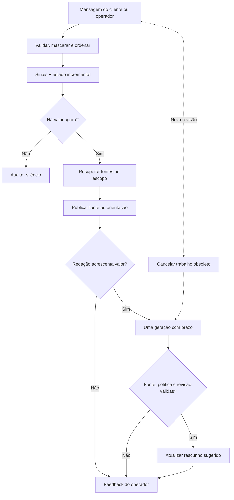

# 2. Decisões arquiteturais

## Recomendação provisória

Adotar **pipeline orientado a eventos com estado incremental e política explícita de intervenção**, preservando A/B como controles experimentais. É uma escolha de engenharia para este escopo, não um vencedor comprovado em produção.

O protótipo usa um processo FastAPI, tarefas assíncronas e memória por sessão. Não necessita Kafka, multiagentes, um grafo de dezenas de nós ou um LLM sempre observando. “Event-driven” descreve o acionamento e o ciclo de vida; não exige um broker distribuído no MVP.

O conhecimento é fictício e aprovado exclusivamente para o laboratório. A interface não se conecta a nenhum banco nem envia mensagem real a clientes.

## Comparação das abordagens executáveis

| Decisão | A — LLM por turno de cliente | B — sinais + geração seletiva | C — estado + oportunidades |
|---|---|---|---|
| Gate inicial | Só controles universais de segurança/postura | Sinais e confiança heurística | Sinais, confiança e valor contextual |
| Memória fornecida ao modelo | Janela recente de até 8 turnos | Turno atual | Estado + janela recente |
| Supressão de repetição | Modelo decide em execução real | Ausente por desenho do baseline | Fingerprint, janela temporal e condução do operador |
| Geração | Uma tentativa por turno elegível | Uma tentativa por candidato | Apenas quando uma síntese ajuda |
| Sem credenciais | Substituto por template explicitamente rotulado | Mesmo substituto | Caminhos determinísticos nativos |
| Risco principal | Custo/tempo e excesso de intervenção | Classificação local não entende a condução | Regras suprimirem uma oportunidade nova |

A, B e C compartilham corpus, apresentação, guardrails e adaptador. **A no modo demo não é um LLM emulado**: apenas permite observar quantos turnos chegariam à geração e o comportamento de um substituto por template. Resultados de qualidade do LLM A/B/C exigem execução autenticada e avaliação humana.

## O que suas premissas precisam ajustar

- **Ler só o cliente é insuficiente.** Sem falas do operador, conclusão de passos ou feedback, “já está conduzindo” vira chute. O playground exige o papel do participante.
- **Uma chamada é um orçamento, não um dogma.** Mantemos zero/uma por candidato no experimento. A perda de cobertura pode justificar um pequeno classificador ou fallback antes da geração; o ganho precisa superar seu tempo e custo. Não acoplar isso a um novo agente autônomo.
- **BM25 não é compreensão de intenção.** No runtime é retrieval. No experimento de detectores pode comparar frases com exemplos rotulados, porém o score não é probabilidade.
- **Sentimento não equivale a risco de cancelamento.** Expressão de preço, intenção de sair e emoção são dimensões distintas. “Muito caro” não autoriza diagnóstico emocional.
- **Até 300 caracteres serve para um rascunho.** Fonte e contexto ficam fora desse limite. Não truncamos um texto longo às cegas; rejeitamos a geração que viola o contrato.
- **Conhecimento primeiro não exige LLM primeiro.** Um trecho verificável ou uma pergunta autorizada pode resolver o próximo passo.
- **Sub-500 ms local não valida um SLA.** Rede, carga, recuperação corporativa, políticas externas e apresentação ainda precisam entrar na medida.

## Seleção de sinais

| Técnica | Onde ajuda | Limitação | Implementação/experimento |
|---|---|---|---|
| Regex/regras | Termos críticos, produto explícito, resolvido, padrões de ataque | Negação, ironia, escopo e paráfrase | Runtime; evidência textual registrada |
| BM25 | Termos exatos e exemplos rotulados | Pouca generalização além do vocabulário | Retrieval e estudo de classificação por exemplos |
| TF-IDF de caracteres | Variações de escrita e termos próximos | Não é embedding semântico | Híbrido local + comparação de detectores |
| Embeddings semânticos | Paráfrases e recuperação conceitual | Custo, dependência de modelo, falsos similares | Adaptador local opcional; não medido sem pesos |
| Classificador linear pequeno | Assuntos bem delimitados, execução barata | Requer exemplos/holdout e calibração | Experimento independente, não ativado automaticamente no runtime |
| SLM/classificador neural | Contexto curto, linguagem variável | Inferência adicional e possíveis alucinações | Não executado; exigir teste de ganho marginal antes de integrar |

Os scores 0,9/0,85/0,72/0,35 das regras são **heurísticas de engenharia**. Não apresentar “90% de certeza” ao operador. O experimento do classificador também não calibra probabilidades. Adotar curvas precisão/cobertura por classe, Brier/ECE após conjunto de calibração independente, e limiares separados por risco antes de produção.

## Estado e motor de oportunidades

O estado contém produto, assunto, intenção, momento, pendência, reclamação aberta, indícios de sentimento, condução pelo operador e oito turnos recentes. Atualização incremental evita passar todo o histórico a cada evento. A auditoria é limitada a 300 eventos por sessão.

Ordem da decisão: segurança → postura solicitada → papel → resolução → candidato/prioridade → confiança → deduplicação/dispensa → condução → cooldown. Reclamação aberta bloqueia orientação comercial em C. Alertas graves podem ultrapassar cooldown, mas não repetir um alerta equivalente já tratado.

Configuração inicial **não calibrada**: confiança mínima 0,70; cooldown de 8 s no mesmo assunto; deduplicação de 90 s; card expira em 45 s; evidência de condução dura 25 s. Esses valores existem para experimentar e devem variar por canal e tipo de orientação. Não são benchmarks de fornecedores.

Prioridades: segurança 100, possível saída 85, investigação 60, resposta 50, ambiguidade 40, documento 30. O playground exibe uma intervenção principal de cada vez; fontes ficam dentro dela. O valor esperado é categórico e explicável, não um score monetário inventado.

Fingerprint = produto + assunto + tipo + intenção. É simples e deliberadamente imperfeito: duas dúvidas diferentes sobre anuidade podem parecer equivalentes. O conjunto de desafio registra esse problema. Próxima melhoria: chave de **necessidade pendente** com predicado/objeto, antes de adicionar similaridade ou outro modelo.

## Reuso do harness

| Compartilhado | Específico do proativo |
|---|---|
| Ontologia, normalização e evidência | Assinatura do fluxo de eventos |
| Recuperação e fontes aprovadas | Decidir se e quando interromper |
| Política de resposta e validação | Cooldown, dedup, obsolescência e expiração |
| Adaptador de LLM e esquema de saída | Estado da condução e oportunidades |
| Documentos do domínio e voz de resposta ao cliente | Orçamento visual e prioridade |
| Interface futura de ferramentas e contexto autorizado | Métricas de silêncio, cobertura e ruído |

A postura reativa requer pedido explícito e ignora a política de interrupção, mas preserva segurança e fontes. No MVP a persona é única: operador humano, linguagem acolhedora em português. **Não foram implementadas seleção dinâmica de persona, skills externas instaláveis ou ferramentas transacionais.** “Skill de conhecimento” é hoje um módulo Python reutilizável; um arquivo SKILL.md não é requisito para isso.

## Latência, custo e recuperação

- Pré-computação: tokenização, estatística BM25 e matriz vetorial no início do processo.
- Cache de retrieval: chave com consulta, produto, assunto, modo, público e versão da base; LRU de até 256 entradas, validade de 300 s. Não há cache compartilhado de resposta personalizada.
- Escopo: filtro duro de produto/assunto/público antes de exibir; até três documentos, com versão. Pergunta sem assunto pede esclarecimento e não faz recuperação especulativa em B/C.
- Híbrido: BM25 + TF-IDF morfológico via Reciprocal Rank Fusion. Com um modelo local configurado, o componente vetorial passa a ser semântico. Os rótulos identificam o modo.
- CPU: execução local síncrona por ser pequena. Para corpora/modelos maiores, deslocar para serviço ou executor limitado, medir tempo de fila e testar a paralelização das buscas independentes. Não criar threads apenas para oito documentos.
- Geração: cliente HTTP reutilizado; sem retries ocultos; sem chamadas em cadeia; limite global de concorrência; deadline inclui espera pelo semáforo. Default 3,2 s é orçamento experimental, não promessa de completion.
- Streaming: eventos de estado, decisão, card, trace e conclusão. O texto gerado só aparece após validação; o template fundamentado pode aparecer antes. Não transmitimos tokens não verificados como recomendação final.
- Latest-wins: qualquer nova mensagem cancela o processamento pendente; revisão conferida na publicação. Cancelar o cliente HTTP não garante interrupção de cobrança no provedor.
- Output: até 300 caracteres; tokens de entrada/saída reais quando informados pelo provedor. Limitar caracteres não equivale a limitar tokens internos de raciocínio.

A documentação OpenAI recomenda reduzir gerações e pedidos, paralelizar dependências independentes e não usar LLM como default [O1]. A decisão de manter templates aqui é consistente com esses princípios, sem provar latência de um modelo específico. Structured Outputs ajuda o formato [O2]; não garante verdade factual.

## Opções adiadas

- Multiagentes por produto/persona: não há tarefas independentes que justifiquem coordenação, latência e duplicação.
- LLM em todas as mensagens como default: permanece baseline A; escolher só se ganhos de cobertura/qualidade justificarem custo.
- Loop contínuo por polling: substituído por evento. Um timer é apropriado depois para detectar pendência esquecida; não está implementado no MVP.
- Ontologia extensa/knowledge graph: desnecessários para oito documentos e um vocabulário pequeno.
- Reranker em toda busca: avaliar somente no subconjunto ambíguo e com ganho medido de fonte correta.
- Ferramentas transacionais: requerem autorização, estado externo e idempotência próprios. Fora deste protótipo knowledge-first.
